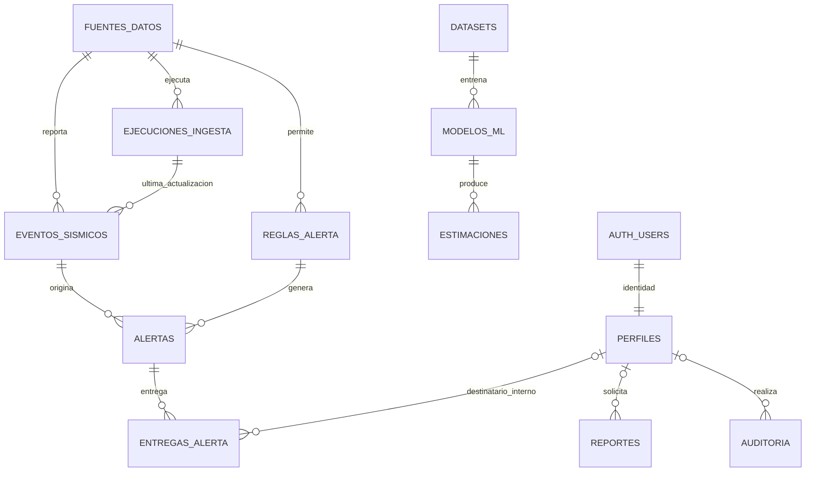

# Base de datos de SISMOCORE para Supabase

## Decisión

Para completar el alcance funcional del proyecto y del PDF se proponen **12 tablas propias**, sin duplicar las tablas internas de Supabase. Para las funciones que hoy tienen código de datos bastan fuentes_datos, ejecuciones_ingesta y eventos_sismicos; perfiles se necesita al incorporar autenticación. Las otras ocho responden a módulos pendientes del plan, no a la tabla/mapa actuales.

No existe un número mínimo universal: esta propuesta es mínima bajo las decisiones explícitas de un rol principal por usuario, una fuente permitida por regla, datasets congelados en archivos y un registro único por versión de experimento/modelo. Si se solicitan roles combinables, libre configuración de permisos o contactos/grupos administrables, será otro alcance y requerirá relaciones adicionales.

La migración preparada está en `supabase/migrations/20261021000100_esquema_sismocore.sql`. Es una instalación inicial transaccional para Supabase vacío, no una transformación de tablas existentes. No se ha aplicado a ningún proyecto remoto y no cambia todavía los servicios de la aplicación.

## Las doce tablas y por qué existen

| Tabla | Responsabilidad | Por qué no se elimina o fusiona |
|---|---|---|
| perfiles | Nombre, rol principal y estado del usuario Auth | Auth resuelve identidad, pero no los permisos de SISMOCORE. No duplica contraseñas ni sesiones. |
| fuentes_datos | Conector, parámetros, frecuencia, límites y cursor | La fuente tiene configuración e identidad estables, diferentes de los eventos y las ejecuciones. |
| ejecuciones_ingesta | Una sincronización con tiempos, contadores y errores | Una fuente tiene muchas ejecuciones, incluso ejecuciones sin eventos o fallidas. |
| eventos_sismicos | Catálogo de observaciones sísmicas | Entidad central de tabla, mapa, dashboard, análisis y reglas. |
| datasets | Versión congelada de datos, preparación y calidad | Los eventos cambian por revisiones; un entrenamiento necesita su muestra exacta reproducible. |
| modelos_ml | Un experimento/version con configuración, entrenamiento, métricas y aprobación | Reúne ml_experiments y model_registry del PDF; no hay una segunda entidad independiente que justifique duplicarlos. |
| estimaciones | Resultado experimental por modelo, zona y ventana | Un modelo produce muchos resultados; separarlos impide confundirlos con eventos observados. |
| reglas_alerta | Condición, fuente, zona, canales y destinatarios | La regla es reutilizable, modificable y existe antes de cualquier alerta. |
| alertas | Aviso generado para un evento por una regla | Conserva mensaje, contexto, aprobación e historial auditado del aviso. |
| entregas_alerta | Resultado por alerta, canal y destino | Una alerta puede entregarse a varios destinos y fallar solo en algunos. No cabe en un único estado de alertas. |
| reportes | Solicitud, filtros/corte, archivo, estado y vencimiento | Un archivo generado tiene propietario y ciclo de vida propios. |
| auditoria | Acciones administrativas y cambios críticos | Es transversal y debe conservar acceso restringido y escritura sin actualización/borrado ordinarios. |

## Lo que no tendrá una tabla propia

- **Dashboard, mapa, gráficas, estadísticas y KPI:** consultas agregadas y resultados filtrados de eventos; no copias del catálogo.
- **Usuarios, contraseñas, sesiones, recuperación y factores MFA:** Supabase Auth. perfiles.id referencia la clave primaria auth.users.id. El correo y último acceso se consultan a Auth desde el backend autorizado.
- **roles y user_roles:** un rol fijo por perfil, validado con CHECK. Los cinco roles son administrador, analista, operador, auditor y lectura.
- **Registro separado de modelos:** versión, aprobación, artefacto y métricas viven en modelos_ml.
- **Filas de cada dataset:** snapshot privado Parquet/CSV con hash; evita una tabla puente enorme y conserva los valores originales aunque un evento sea revisado después.
- **Intentos de entrega:** historial JSONB dentro de cada entrega. Adecuado con reintentos acotados; no se necesita administrar o consultar cada intento como una entidad independiente. Si ese uso cambia, se normaliza.
- **Archivos/adjuntos:** Supabase Storage; las tablas guardan paths y SHA-256, no binarios ni URLs firmadas que caducan.
- **Contactos, grupos y suscripciones:** no hay gestión de agenda ni suscripciones implementada o definida como módulo. Una regla guarda una lista validada de destinos o usuarios; cada entrega congela el destino concreto. No usar un nombre de grupo sin resolver destinatarios reales.
- **Zonas geográficas:** el alcance inicial no administra un catálogo propio; GeoJSON/bbox en reglas y estimaciones, región textual en eventos. No crear departamentos/provincias/distritos sin tener un módulo o fuente que los resuelva.
- **Configuración general:** variables seguras para infraestructura, campos de fuente para ingesta y campos de regla para alertas. No hay actualmente una configuración operativa independiente que justifique una tabla genérica clave/valor.
- **Estaciones/sensores:** la fuente actual entrega eventos; la tarjeta de estaciones no justifica inventar una entidad sin datos ni funcionalidad definidos.

## Relaciones reales



Además hay claves foráneas de responsables/aprobadores en datasets, modelos, estimaciones, reglas, alertas e ingestas. Se omiten del diagrama para mantenerlo legible. Los FK históricos de actores usan SET NULL al borrar un perfil; el contenido de negocio se conserva. La relación Auth/perfil se elimina en cascada.

No se dibuja un FK de eventos a datasets porque no existe: el dataset guarda una copia congelada en Storage. La especificación y el manifiesto incluyen fuentes, consulta, corte y transformaciones, y el archivo incluye los identificadores y metadatos de procedencia por fila. Un hash sin el archivo conservado no permite reproducibilidad.

## Campos definidos

Los detalles ejecutables de tipo, nulabilidad, CHECK, índices y FK están en el SQL. Estos son los campos de cada tabla, sin entidades pendientes de decidir:

### perfiles

id UUID de Auth; nombre_completo; rol; estado pendiente/activo/suspendido; creado_en y actualizado_en.

Se crea al dar de alta una identidad. El rol siempre nace como lectura y el estado pendiente: no se toman roles de metadatos editables por el usuario. El primer administrador se activa desde SQL de confianza. No hay registro público que otorgue acceso automáticamente.

### fuentes_datos

id; codigo único; nombre; organizacion; url_api HTTPS; tipo; activa; frecuencia_segundos; parametros JSONB; limites JSONB; licencia_url; contacto; secreto_ref; cursor_sincronizacion JSONB; creado_en; actualizado_en.

parametros almacena filtros del conector, no credenciales. limites registra tamaño de página, timeout y límites verificados. secreto_ref identifica un secreto externo si se necesita. El estado de salud, último intento y último éxito se calculan desde ejecuciones_ingesta; no se mantienen contadores duplicados.

La semilla inicial usa la URL y cobertura USGS existentes en código. La frecuencia inicial de cinco minutos es una propuesta configurable, no un límite oficial comprobado del proveedor. La licencia queda pendiente de verificar; no se inventan términos.

### ejecuciones_ingesta

id; fuente_id; solicitado_por; estado; iniciado_en; finalizado_en; parametros exactos; cursor_resultado; registros_recibidos/insertados/actualizados/rechazados/sin_cambios; calidad JSONB; error_resumen; correlacion_id.

calidad guarda rechazos agrupados por causa y métricas de nulos/rangos. La duración se calcula desde los timestamps. Hay una sola ejecución en cola/ejecutando por fuente; el worker debe cerrar ejecuciones abandonadas y usar adquisición atómica del trabajo. El índice evita superponer ingestas, pero no es un programador de tareas.

### eventos_sismicos

id UUID interno; fuente_id; id_externo; ocurrido_en; latitud; longitud; magnitud nullable; tipo_magnitud; profundidad; region nullable; lugar; estado_revision; url_fuente; recibido_en; actualizado_fuente_en; actualizado_en; hash_origen SHA-256; ultima_ingesta_id.

Magnitud puede ser negativa o faltar; profundidad puede ser negativa si así la reporta la fuente. No se impone profundidad >= 0 ni un intervalo de magnitud arbitrario. Coordenadas son obligatorias y están limitadas a rangos geográficos. Los datos numéricos no finitos se rechazan.

Unicidad (fuente_id,id_externo). El FK compuesto ultima_ingesta_id/fuente_id evita asociar un evento a la ejecución de otro proveedor. Upsert por esa clave; recibido_en se conserva y actualizado_fuente_en/hash controlan revisiones. ultima_ingesta_id indica la ejecución que modificó por última vez la fila, no todas las veces que fue leída.

La deduplicación es por proveedor. Dos fuentes pueden reportar el mismo fenómeno con identificadores distintos: no deben fusionarse por proximidad de forma ingenua. Con una sola fuente inicial no hace falta otra tabla de correspondencias.

### datasets

id; nombre; version; estado; especificacion; periodo_inicio/fin; numero_filas; informe_calidad; transformaciones; particion_temporal; snapshot_path; snapshot_sha256; creado_por/en; aprobado_por; publicado_en.

especificacion contiene filtros, fuentes incluidas, fecha de corte, columnas y criterio de selección. transformaciones documenta pasos ordenados, parámetros, imputación/codificación y versión del pipeline. particion_temporal registra cortes, no solo porcentajes aleatorios. El informe contiene nulos, duplicados y rechazos por campo/fuente.

Una versión publicada no cambia su contenido ni se borra; puede archivarse. Se conserva el snapshot incluso si los eventos originales son actualizados. Nuevos datos/limpieza implican una nueva versión.

### modelos_ml

id; nombre; version; dataset_id; objetivo; tarea; algoritmo; features; target; hiperparametros; semilla; versiones_librerias; validacion; metricas; baseline; estado; artefacto_path; artefacto_sha256; limitaciones; error_resumen; creado_por/en; entrenamiento_inicio/fin; aprobado_por/en.

Una fila representa un entrenamiento concreto con su versión, incluso si falla. Cambiar parámetros/dataset implica otra versión. Los modelos aprobados tienen contenido protegido; pueden retirarse. Solo se entrena con dataset publicado/archivado, nunca borrador. validacion guarda ventana y estrategia; metricas incorpora MAE/RMSE/R² o precision/recall/F1/confusión/calibración según corresponda. El backend valida el esquema de esas métricas.

No se guarda un segundo dataset_id en estimaciones: se obtiene desde el modelo, evitando dos referencias contradictorias.

### estimaciones

id; modelo_id; zona y zona_codigo; ventana_inicio/fin; metrica; valor; limite_inferior/superior; incertidumbre; calculado_en; estado; revisado_por/en; advertencia.

zona_codigo es una clave canónica para deduplicar; zona conserva su definición en el cálculo. Limites numéricos, si existen, deben venir en pareja y contener valor. Si metrica representa probabilidad, el backend valida [0,1]; no se impone a todos los indicadores porque algunos son regresiones numéricas.

Solo se publica con modelo aprobado y revisión. Las salidas publicadas mantienen su contenido; retirar el modelo después no borra su historia. No hay FK ni conversión automática de estimaciones a alertas.

### reglas_alerta

id; nombre; version; fuente_id; tipo evento_observado; magnitud_minima; profundidad_maxima; zona; severidad; canales; destinatarios; horario; cooldown_segundos; plantilla; requiere_aprobacion; activa; creado_por/en; aprobado_por/en; actualizado_en.

Una regla permite una fuente para evitar una tabla puente sin necesidad actual. zona: {} para toda la cobertura, o bbox/GeoJSON validado. destinatarios: lista de objetos con canal y destino concreto o usuario_id. horario incluye zona horaria explícita, por ejemplo America/Lima. El backend valida forma, coincidencia canal/destino, dominios permitidos de webhook y contenido de plantilla. Cambios funcionales incrementan version y requieren aprobación de activación.

Los niveles son operativos internos, no niveles oficiales de peligro. Secretos de SMS, email o webhooks se guardan fuera de esta tabla.

### alertas

id; evento_id; regla_id; regla_version; severidad; titulo; mensaje; url_fuente; contexto; estado; creado_en; actualizado_en; aprobado_por/en; correlacion_id.

Una alerta única por evento/regla, aunque cambie la versión de la regla: la versión generadora queda congelada. contexto contiene los valores del evento usados al decidir, la condición/versión y el tipo de aprobación; así una revisión posterior del proveedor no reescribe la justificación histórica.

El trigger de inserción comprueba fuente compartida, regla activa y versión vigente. La comprobación de umbral/zona/horario/cooldown es responsabilidad del motor de reglas. Las alertas que no requieren aprobación humana conservan aprobación de sistema con timestamp y contexto explícito; no simulan una aprobación humana.

### entregas_alerta

id; alerta_id; canal; destinatario; usuario_id opcional; estado; intentos; historial_intentos; proximo_intento_en; ultimo_intento_en; entregado_en; error_codigo; proveedor_mensaje_id; acuse_en; creado_en; actualizado_en.

Unicidad (alerta_id,canal,destinatario). El destino debe canonicalizarse antes de insertar. historial_intentos incluye timestamp, resultado y código seguro de error, nunca tokens; su longitud coincide con intentos. El worker actualiza ambos de forma atómica y adquiere cada entrega con bloqueo o actualización condicional.

El UUID de entrega se usa como clave idempotente con proveedores que lo soporten. La restricción SQL evita filas duplicadas, pero por sí sola no garantiza envío exactamente una vez si el proveedor no ofrece idempotencia. Debe reconciliarse el identificador del proveedor después de una interrupción.

### reportes

id; nombre; tipo; formato; filtros; fecha_corte; manifiesto; solicitado_por; estado; archivo_path; archivo_sha256; error_resumen; creado_en; finalizado_en; expira_en.

manifiesto conserva fuentes, versiones, consulta/pipeline, muestra y metadatos necesarios para explicar el archivo. El archivo generado es inmutable y su hash verifica integridad. Regenerar exactamente desde un catálogo mutable necesita un snapshot conservado; una fecha de corte sola no basta. No se promete reconstrucción exacta sin ese snapshot. El borrado del objeto al caducar requiere una tarea; el CHECK no elimina archivos.

### auditoria

id; actor_id; actor_tipo; accion; entidad; entidad_id; antes; despues; resultado; ocurrido_en; correlacion_id; ip opcional.

entidad_id es intencionadamente polimórfico, no un FK a una única tabla. Se conserva tras borrar una entidad. Los triggers registran cambios críticos con campos permitidos, sin copiar contactos, mensajes ni secretos. La ingesta masiva usa ejecuciones_ingesta; no se crea una fila de auditoría por cada lectura/evento recibido.

Los endpoints deben añadir eventos de denegación, exportación, pruebas de regla y modificaciones cuyo detalle no esté cubierto por el trigger. FastAPI debe registrar actor/correlación explícitos si escribe con service_role por REST; ese token no representa al usuario final. Por conexión transaccional puede usar SET LOCAL app.actor_id/app.correlacion_id. Revocar UPDATE/DELETE al servicio no impide al propietario de PostgreSQL administrar o eliminar datos: es protección operativa, no almacenamiento inviolable.

## Contrato con el frontend y backend actuales

La interfaz actual consume id, magnitud, lugar, latitud, longitud y profundidad desde /api/v1/eventos/. Esos nombres se conservan en la tabla; id cambia a UUID interno y el identificador del proveedor pasa a id_externo.

| Función | Datos que debe consultar |
|---|---|
| GET /api/v1/eventos/ | eventos_sismicos JOIN fuentes_datos, con filtros/paginación reales. |
| Detalle de evento | Evento por UUID y su proveedor; fuente/hora/URL visibles. |
| Mapa | Mismo filtro de eventos; conversión a GeoJSON si se desea. |
| Dashboard | COUNT, MAX, promedios/medianas, GROUP BY tiempo/magnitud y última ingesta. |
| Estado de fuentes | fuentes_datos + ejecuciones_ingesta, calculando último intento/éxito/latencia. |
| Calidad/datasets | ejecuciones_ingesta para recepción y datasets para calidad de preparación. |
| ML | datasets + modelos_ml; artefactos privados. |
| Resultados experimentales | estimaciones + modelos_ml; solo publicaciones autorizadas. |
| Reglas/alertas | reglas_alerta + alertas + entregas_alerta. |
| Reportes | reportes y archivo privado firmado tras verificar autorización/expiración. |
| Usuarios | perfiles + API administrativa de Auth desde backend. |
| Auditoría | auditoria con acceso restringido. |

**No mantener la llamada directa a USGS dentro de cada lectura de eventos.** El flujo objetivo es USGS → worker de ingesta → tablas → FastAPI → React. Si se conserva el endpoint actual como proxy, la base quedaría desconectada del proyecto aunque las tablas existan.

Hay que modificar api.ts, el tipo EventoSismico, el endpoint eventos.py y el dashboard/mapa para consumir la persistencia y sus metadatos. No se han hecho esas modificaciones en esta tarea de diseño.

## Acceso en Supabase

- Supabase Auth maneja identidad. perfiles.id solo referencia su PK; no se copia email/contraseña.
- RLS habilitado en las doce tablas. Sin acceso anónimo; lectura autenticada según perfil activo y rol.
- No se permite escritura directa desde navegador en esta primera arquitectura: todos los INSERT/UPDATE/DELETE van por FastAPI/worker autorizado.
- La clave secret/service_role vive solo en servidor y omite RLS. FastAPI debe validar JWT, perfil activo y permisos antes de cada operación; RLS no protege una llamada privilegiada mal autorizada.
- Auditoría y contactos no se exponen a todos los roles. Los DTO de FastAPI deben reducir los campos necesarios, especialmente para fuentes y entregas.
- Bucket privado sismocore-privado con prefijos datasets/, modelos/ y reportes/. No hay políticas de cliente para esos objetos; el backend entrega URLs firmadas solo después de autorizar. No abrir el bucket para arreglar errores de acceso.
- El esquema sismocore_private contiene funciones auxiliares, no tablas. No añadirlo a los esquemas expuestos de la Data API.
- No existen vistas creadas en esta migración. Si se añaden para métricas, deben respetar permisos/RLS; no son tablas adicionales.

## Aplicación e integración

1. Revisar que el proyecto Supabase de destino esté vacío respecto a estas tablas. Si tiene datos, primero inspeccionar el esquema; no usar DROP ni adaptar a ciegas.
2. Aplicar la migración completa mediante CLI de Supabase o SQL Editor. Requiere permisos de propietario para trigger de Auth, grants y bucket.
3. Crear/invitar al primer usuario desde Auth. Tomar su UUID real y activar su perfil:

   ```sql
   update public.perfiles
   set rol = 'administrador', estado = 'activo'
   where id = '<UUID_REAL_DEL_USUARIO_AUTH>'::uuid;
   ```

4. Configurar servidor con URL/clave privada o conexión PostgreSQL; configurar frontend con URL y clave pública si usa Auth. No poner service_role en variables VITE_*.
5. Implementar autorización de FastAPI antes de habilitar endpoints privilegiados.
6. Adaptar el conector USGS: capturar ID externo, fecha, URL, revisión y tipo de magnitud; validar; calcular hash; crear ejecución; upsert; cerrar contadores; actualizar cursor solo después de persistir correctamente. Solicitar revisiones con solapamiento temporal/fecha de actualización del proveedor.
7. Cambiar la ruta Eventos para leer PostgreSQL. Ejecutar dos veces la misma ingesta y comprobar unicidad y conservación de recibido_en.
8. Conectar dashboard/mapa/filtros y después los módulos restantes.
9. Subir snapshots/modelos/reportes por Storage API; no modificar manualmente storage.objects. Publicar metadatos solo después de subir y verificar hash; limpiar archivos huérfanos si falla la transacción de metadatos.
10. Añadir programación, recuperación de trabajos abandonados, reintentos, backups y pruebas del entorno real.

No hay registros sísmicos persistidos que trasladar desde esta copia: será una creación inicial y carga desde USGS, no una migración de un catálogo existente.

## Qué se valida y qué queda pendiente

La revisión estática comprobó cantidad de tablas, referencias internas, cobertura RLS y privilegios declarados. Se analizaron sintácticamente las 72 sentencias de migración y las 53 del archivo de pruebas con pglast.

Además, se ejecutó la migración completa en PostgreSQL embebido con @electric-sql/pglite 0.5.10 y esquemas Auth/Storage simulados. Pasaron las 31 aserciones explícitas del SQL de pruebas, más las comprobaciones del runner sobre doce tablas y rollback. Se verificaron duplicados, rangos/nulos/NaN, coherencia fuente/ingesta, exclusión de ingestas simultáneas, datasets publicados, modelos aprobados, estimaciones, versión/fuente de reglas, entregas e intentos, lectura RLS, suspensión, denegación de cambios de rol, auditoría y baja de una identidad preservando publicaciones históricas.

El SQL en supabase/tests/esquema_sismocore.sql también está preparado para ejecutarse en un proyecto Supabase de prueba vacío después de la migración; usa transacción con rollback. El runner verificar_local.mjs permite repetir la prueba embebida; requiere instalar @electric-sql/pglite 0.5.10 en un directorio temporal y definir PGLITE_MODULE con la ruta absoluta a su dist/index.js, o tener el paquete resoluble desde Node. Las dependencias temporales de validación no forman parte de la aplicación.

Queda pendiente ejecutar las pruebas en Supabase real, donde existen los servicios completos de Auth/Storage y sus permisos. La prueba embebida verifica ejecución de SQL, triggers y RLS, pero no sustituye integración con Auth real, acceso Storage por API, worker, JWT de FastAPI o navegador. No se aplicó ninguna migración remota ni se modificó el código funcional actual.

## Referencias oficiales consultadas

- [Supabase: gestión de usuarios y perfiles](https://supabase.com/docs/guides/auth/managing-user-data).
- [Supabase: RLS, grants y service_role](https://supabase.com/docs/guides/database/postgres/row-level-security).
- [Supabase: buckets privados y acceso firmado](https://supabase.com/docs/guides/storage/buckets/fundamentals).

La cantidad y organización de tablas son decisiones de diseño basadas en este proyecto; las fuentes anteriores sustentan la integración con Supabase.
